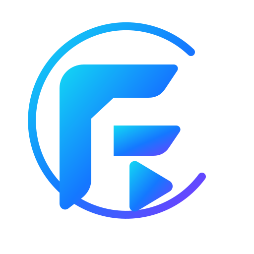
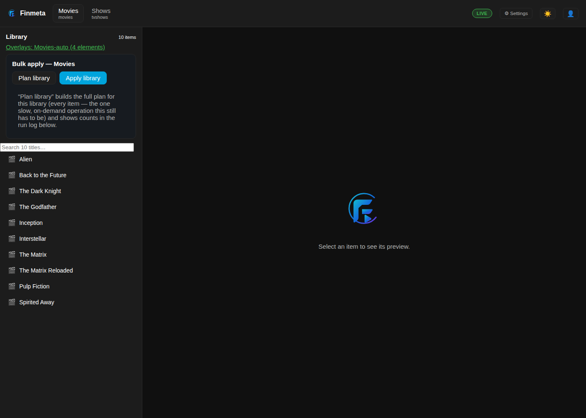
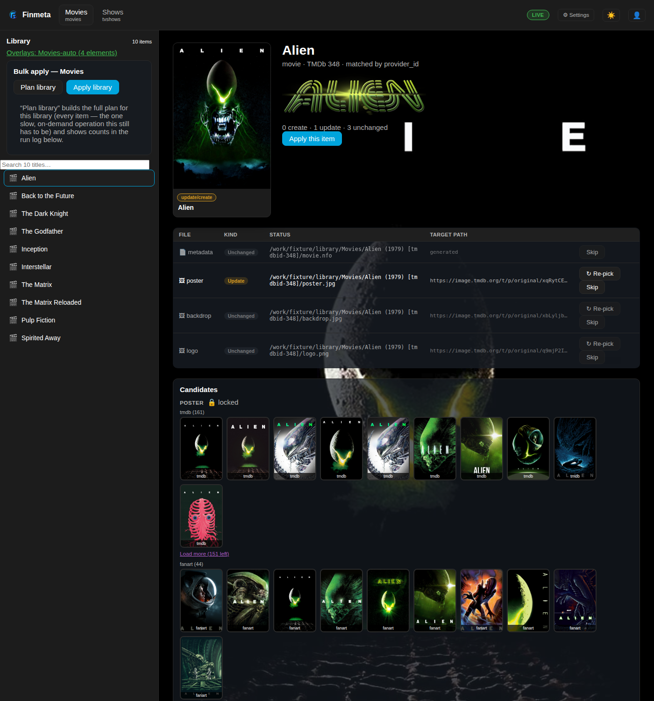
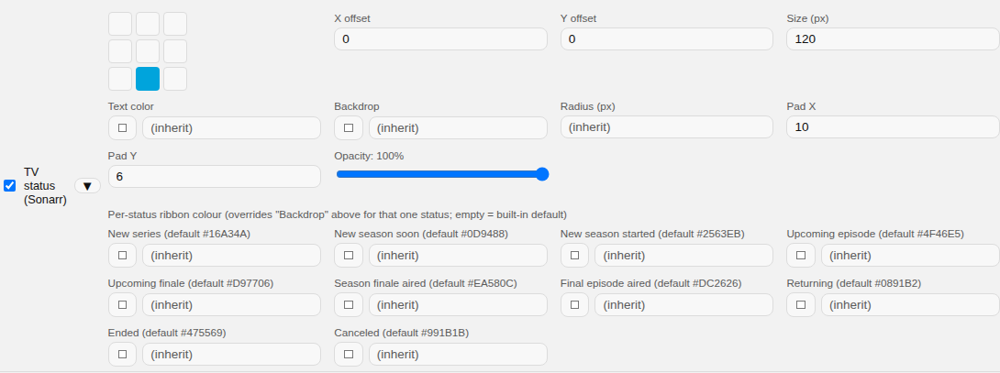
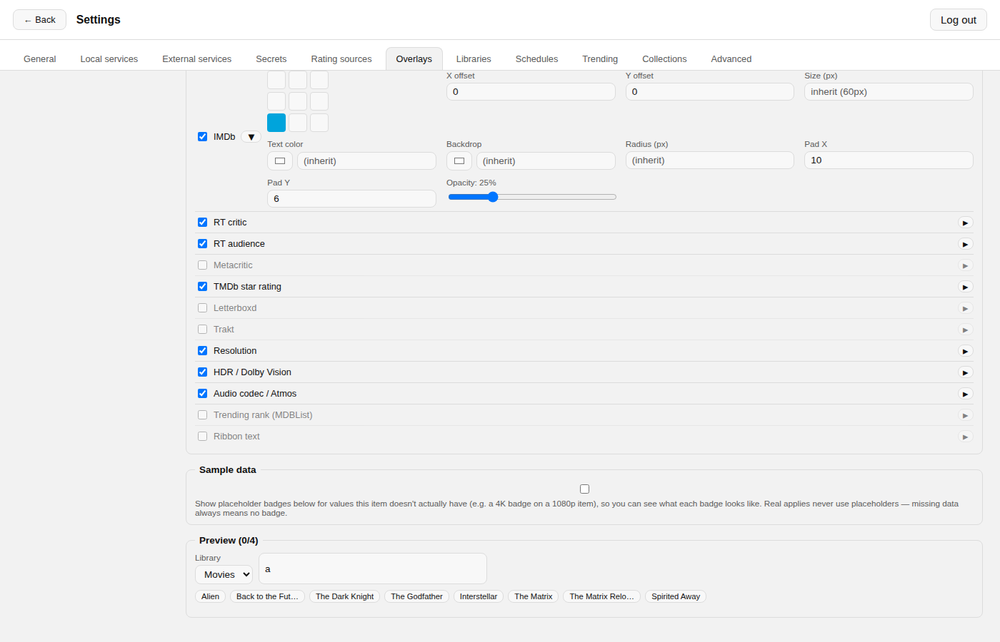

<p align="center">
  
</p>

# Finmeta

Finmeta is a self-hosted metadata and artwork manager for **Jellyfin** —
a Jellyfin-native alternative to [Kometa](https://kometa.wiki) (formerly
Plex Meta Manager). It enriches selected libraries with metadata, artwork,
poster overlays, theme music, collections and playlists, and ships with a
web UI for configuration, live preview, and plan/apply control.

> Status: 1.0, actively developed. Core flows (plan → apply → undo,
> overlays, collections, trending, TV status) work end-to-end against a
> real Jellyfin server. See the open items in the repo's issue tracker
> for what's still in progress.

## Screenshots

<table>
<tr>
<td width="50%">

**Library browser** — plan/apply per item or for the whole library


</td>
<td width="50%">

**Artwork candidates** — every matching poster, ranked, one click to pick


</td>
</tr>
<tr>
<td width="50%">

**Overlay editor** — per-status TV ribbon colours and position/offset,
tuned independently of every other overlay element


</td>
<td width="50%">

**Overlay preview** — pick any library, search for a title, see the
rendered poster before anything is written


</td>
</tr>
</table>

## Why not just use Kometa?

Kometa is built around Plex first, with Jellyfin support layered on top.
Finmeta is Jellyfin-native from the ground up: it talks to the Jellyfin API
directly, understands Jellyfin's own image/NFO conventions, and its UI is
built for Jellyfin's data model rather than translated from Plex's. It can
also import an existing Kometa `config.yml` (overlay blocks, defaults with
`template_variables`, and collection definitions) to ease migration.

## Features

- **Plan first, apply second** — every change is computed as a reviewable
  `WritePlan` (CLI diff or UI preview) before anything touches disk or
  Jellyfin.
- **Safe by default** — `dry_run: true` out of the box, automatic backups,
  a per-run manifest, and full `undo`.
- **Metadata & artwork** from TMDb, fanart.tv, OMDb, MDBList and local
  assets, with configurable source precedence per field.
- **Poster overlays** — resolution, HDR, audio codec, ratings, network
  badges, TV show status — rendered in a style compatible with Kometa's
  defaults, including importing Kometa overlay YAML and image packs.
- **Collections** — preset builders (TMDb collections, genre/year filters,
  curated lists) plus an "Adaptive Seasonal Collections" toggle that
  mirrors Kometa's own seasonal calendar (Halloween, Christmas, etc.).
- **Trending & TV status** via MDBList and Sonarr/Radarr integration.
- **Playlists**, theme music management, and a scheduler for unattended
  runs.
- **Web UI** for configuration, library browsing, overlay/collection
  preview, and secrets management — no hand-edited YAML required for
  day-to-day use.

## Quick start

Finmeta is a single Python backend (FastAPI) serving a bundled React UI.

### Docker (recommended)

```bash
git clone https://github.com/<your-org>/finmeta.git
cd finmeta
cp docker-compose.yml docker-compose.override.yml   # edit paths/vars, or edit docker-compose.yml directly
docker compose up -d --build
```

On first start, Finmeta copies `config/config.template.yml` into your
mounted `/config` as `config.yml` if none exists yet — `dry_run: true`,
nothing written to Jellyfin or disk until you explicitly apply.

### Without Docker

```bash
git clone https://github.com/<your-org>/finmeta.git
cd finmeta
python -m venv .venv && .venv/bin/pip install -e ".[dev]"

cd ui && npm install && npm run build && cd ..   # builds into backend/finmeta/web/

cp config/config.template.yml config/config.yml  # edit to taste; dry_run stays true until you're ready

export FINMETA_CONFIG=config/config.yml
export JELLYFIN_API_KEY=...                      # or whatever api_key_env you configured
.venv/bin/python -m finmeta.api.server           # serves on :8765
```

Open `http://<host>:8765`, set an admin password on first run, and work
through these three steps in order — **skipping any one of them is the
cause of almost every "nothing happens" report** (see
[Troubleshooting](#troubleshooting) below for the exact symptoms):

1. **Connect your Jellyfin server** (Settings → General) — URL and API key.
2. **Add and enable each library** you want Finmeta to touch (Settings →
   Libraries). This is not automatic: `libraries: {}` is the shipped
   default, and a library you don't explicitly add+enable here is never
   read or written to — it won't even appear as a tab on the main screen.
3. **Set `path_mappings`** (Settings → General) to translate the folder
   paths *Jellyfin itself reports* for your libraries into paths Finmeta
   can actually read/write on disk — see the box below.

Leave `dry_run: true` and run a Plan first — nothing is written to disk or
Jellyfin until you explicitly Apply.

> **`path_mappings` is not the same thing as "pointing Finmeta at Jellyfin."**
> Get it wrong (e.g. leaving the template's default `/media` → `/media`
> when your real library lives somewhere else) and every item in that
> library quietly plans to nothing — no poster, no metadata, no candidates
> to pick from, no error either, just an empty result. Check what path
> Jellyfin reports for the library (its folder path in the Jellyfin admin
> dashboard, under that library's settings) and match `jellyfin:` to it —
> `local:` then has to be a path the Finmeta *container* can actually see
> (see Media volumes below).

### Media volumes

**`artwork_write_method: sidecar` is the only write method** — it writes
`poster.jpg`/`backdrop.jpg`/etc. straight into the media folder next to the
video file, the same convention Kometa/TRaSH use. It needs two things set up
correctly, not just one: `path_mappings` (see above) to translate the folder
paths Jellyfin reports into paths Finmeta can read, *and* your actual media
library mounted into the container at that same `local:` path — e.g. if
`path_mappings` maps Jellyfin's `/data/Movies` to local `/media/Movies`,
your compose file needs `- /path/on/host/Movies:/media/Movies` (or a parent
directory covering it), writable by the container's user. Skip either one
and `sidecar` fails with a permission or not-found error on every write.

An earlier alternative, `jellyfin_api` (uploading artwork straight to
Jellyfin's own API, so Finmeta never needed filesystem access to your
media), was removed 2026-10-26: confirmed running against a real library
that if the item's media folder already has a local poster/backdrop/logo/
fanart file sitting next to the video (common for scene-release folders, or
any library previously scraped by Kodi/Emby-style local artwork), Jellyfin's
own library scanning keeps re-asserting that local file as authoritative —
the upload silently "succeeded" every single apply, Finmeta's own log said
so, but Jellyfin never actually served the new image. That made it
unreliable for most real libraries.

### Configuration

All configuration lives in one YAML file (`config/config.yml`, see
`config/config.template.yml` for every option with comments) and can also
be edited from the UI. Relevant environment variables:

| Variable | Purpose |
|---|---|
| `FINMETA_CONFIG` | Path to `config.yml` (default `config/config.yml`) |
| `FINMETA_HOST` / `FINMETA_PORT` | Bind address (default `0.0.0.0:8765`) |
| `FINMETA_SECRET_KEY` | Encrypts stored secrets (API keys) at rest |
| `FINMETA_AUTH` | Set to `off` only for local development — never in production |
| `FINMETA_COOKIE_SECURE` | Set to `1` when served behind TLS |
| `JELLYFIN_API_KEY`, `TMDB_KEY`, `FANART_KEY`, `OMDB_KEY`, `MDBLIST_KEY`, ... | Named by whatever `*_env` keys you set in `config.yml`; can also be entered via the UI |

API keys, the admin password hash, and the session secret are never
committed to this repository and are not included in the Docker image —
you provide them via environment variables or the UI on first run.

## Troubleshooting

Three setup mistakes cause nearly everything reported as "it's not
working" — match your symptom below before looking anywhere else.

### Nothing shows up on the main screen — no library tabs at all

The library isn't added/enabled in Finmeta's config yet. `libraries: {}`
is the shipped default; nothing is read or written for a library until
you explicitly add it. **Fix:** Settings → Libraries → add the library
(Finmeta reads the real list from your Jellyfin server) and make sure its
`enabled` switch is on. This is a one-time per-library setup step, not
something `path_mappings` or the Jellyfin connection handles for you.

### A library tab shows up, but every item has no poster/metadata — and no error

This is almost always `path_mappings`. The library IS configured and
Finmeta can list its items via the Jellyfin API, but it can't resolve any
item's folder on disk to fetch/write artwork — and a path it can't resolve
produces an empty plan, not an error. **Fix:** open that library's settings
in the Jellyfin admin dashboard and note the exact folder path Jellyfin
reports for it (e.g. `/data/Movies`); then in Finmeta's Settings → General
→ `path_mappings`, set `jellyfin:` to that exact path. `local:` is the
matching path *inside the Finmeta container* — see the next entry for
getting that part mounted correctly.

### "Permission denied" (or files just don't appear) when you Apply a library

Two independent things both have to be true for `sidecar` writes
(`poster.jpg`/`backdrop.jpg`/etc. written next to the video file) to
succeed, and a failure in either one surfaces the same way — an
`apply failed: ... Permission denied: '/media/...'`-style line in the run
log:

1. **The volume is actually mounted, covering the right path.** Your
   compose file's media volume has to cover whatever path `path_mappings`'
   `local:` points to — e.g. if `local: /media/Movies`, you need
   `- /path/on/host/Movies:/media/Movies` (or a parent directory covering
   it) in the `finmeta` service's `volumes:`. A `path_mappings` entry with
   no matching mount behaves exactly like a permissions failure: Finmeta
   can see the path is "there" via Jellyfin's API but can't actually open
   it.
2. **The container's user can write to that host path.** Set `user:` in
   `docker-compose.yml` to the uid:gid that owns your media on the host
   (the example file defaults to `1000:1000`; on Unraid this is usually
   `99:100` — check with `ls -n` on the host media folder). Mismatched
   ownership is the single most common cause of a permission error here,
   especially on Unraid/NAS setups where the media share is owned by a
   non-default user.

If both are correct and you still see a permission error, check that the
host directory itself isn't read-only and that no other process (an
antivirus, a second container) holds an exclusive lock on it.

## Architecture

For a deeper look at how Finmeta is put together — the plan → apply → undo
lifecycle, the package layout, and exactly where Kometa/UMTK compatibility
begins and ends — see [`docs/ARCHITECTURE.md`](docs/ARCHITECTURE.md).

## Credits & acknowledgments

Finmeta would not exist without the prior work of the Kometa/Plex Meta
Manager community:

- **[Kometa](https://github.com/Kometa-Team/Kometa)** (MIT License) — the
  original inspiration and compatibility target. Finmeta does not reuse
  Kometa's code, and does not bundle or ship Kometa's overlay images;
  instead it can *import* a user's own Kometa configuration and, on
  request, download Kometa's defaults from their public GitHub repo at
  runtime. Finmeta's "Adaptive Seasonal Collections" preset is built
  directly from Kometa's published `defaults/movie/seasonal.yml` logic.
- **[Kometa-Team/Community-Configs](https://github.com/Kometa-Team/Community-Configs)**
  contributors, including **bullmoose20**, **Adam-Pope** and
  **JJJonesJr33**, whose shared configs were used as real-world test
  cases for Finmeta's Kometa-import compatibility.
- **[Jellyfin](https://jellyfin.org)** — the media server Finmeta is
  built for.
- **[TMDb](https://www.themoviedb.org)** — the primary metadata and
  artwork source. This product uses the TMDb API but is not endorsed or
  certified by TMDb.
- **[fanart.tv](https://fanart.tv)**, **[OMDb](https://www.omdbapi.com)**
  and **[MDBList](https://mdblist.com)** — optional additional metadata,
  ratings and artwork sources.

Third-party overlay/logo packs and any Kometa assets a user imports
through Finmeta are kept local to that user's own config directory and
are never committed to this repository or shipped in the Docker image —
see `.gitignore`.

## License

MIT — see [LICENSE](LICENSE). Third-party services used by Finmeta (TMDb,
fanart.tv, OMDb, MDBList, Jellyfin) are governed by their own terms; using
Finmeta with those sources means you agree to those terms, including API
key usage limits.
