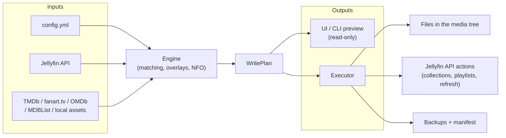
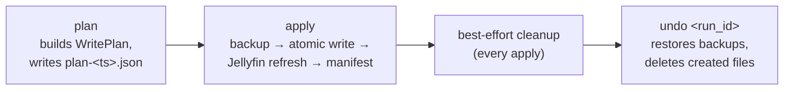

# Architecture

A deeper technical look at how Finmeta is built, how a change travels from
config to disk, and where the project's dependencies on Kometa/UMTK/TMDb
begin and end. See the main [README](../README.md) for what Finmeta does
and how to run it; this document is about how it's built.

## 1. Overview

Finmeta turns a single `config.yml` plus a Jellyfin server and a handful of
metadata sources into a reviewable `WritePlan`, then executes that plan
against the media tree and the Jellyfin API. Every write is backed up,
every run is undoable, and nothing outside the libraries you name in config
is ever touched.

`WritePlan` is the one object both the executor and the UI preview are
allowed to read — the plan is never special-cased per consumer.

| Package | Responsibility |
|---|---|
| `jellyfin_client/` | Typed HTTP client for the Jellyfin API. |
| `sources/` | TMDb, fanart.tv, OMDb, MDBList, local asset directory — all return a common `Candidate`. |
| `arr/` | Sonarr/Radarr clients (TV status, trending). |
| `engine/` | Matching, overlay rendering, NFO generation, collections, `WritePlan`, diffing — most of the logic lives here. |
| `kometa_import/` | Translates a user's Kometa overlay/collection YAML into Finmeta's own format. |
| `config/` | Pydantic v2 config models, secrets handling, hot reload. |
| `api/` | FastAPI app: auth/sessions, scheduler, serves the bundled UI. |
| `cli/` | `finmeta plan \| apply \| undo \| runs`. |

State lives in SQLite (`config/cache.db`: source cache, candidate
selections, job log), `config/runs/<run_id>/` (plan + manifest JSON) and
`config/backups/<run_id>/` (originals saved before being overwritten).

## 2. The plan → apply → undo lifecycle

**Overlays never stack.** Every overlay render starts from the *original*
poster, never from a previous run's output. `engine.runs.find_original_backup`
deliberately returns the **oldest** backup for a path across every run ever
made, not the newest — the only backup that is ever the true pre-Finmeta
original. (An earlier version of this function returned the newest backup
instead, which silently re-composited new badges on top of old ones on
every second apply — now covered by regression tests.)

**Backups are retained, not kept forever.** Every file an apply overwrites
is first copied to `config/backups/<run_id>/`. Left alone this would grow
without bound, so `engine.trash` sweeps it: for each path, only the
**oldest** copy (the true original, needed for the guarantee above and for
a full undo) and the **newest** copy (needed to undo the latest run) are
permanently exempt. Every other copy moves to `config/trash/<run_id>/`
immediately and is permanently deleted once it has sat there longer than
`backup_retention_days` (default 14; `0` disables deletion, not the move).

**The rendered-overlay cache is pruned too.** Separately from the backup
system, `config/cache/overlay/<sha256>.jpg` holds the actual rendered
poster bytes, keyed by their own hash — this lets the executor hand back
*exactly* the bytes a plan already hashed, without re-rendering or
re-fetching anything. A cache entry is deleted once no `plan-*.json` still
on disk references its digest, with a short grace window so a plan that is
still mid-build (whose cache entries land before its own JSON file does)
is never pruned out from under itself. Rendering is a pure function of its
inputs, so an entry pruned a little too eagerly just gets re-rendered next
time it's needed — never a correctness issue.

## 3. Code provenance

Finmeta is Jellyfin-native and self-written. Nothing from Kometa or any
third-party overlay tool is vendored into the source tree; the
dependencies below are all either *data imports the user triggers* or
*standard, independently-licensed libraries*.

| Source | License | How it's actually used |
|---|---|---|
| **Kometa** ([Kometa-Team/Kometa](https://github.com/Kometa-Team/Kometa)) | MIT | `kometa_import/` translates a user's own Kometa overlay/collection YAML into Finmeta's format. Kometa's public overlay images can be downloaded on request into the user's own config directory — never bundled in this repo or the Docker image. No Kometa source code is copied. |
| **Kometa — one exception** | MIT (data, not code) | The date windows and keywords in the built-in "Adaptive Seasonal Collections" preset (Halloween, Christmas, etc.) are copied verbatim from Kometa's own published `defaults/movie/seasonal.yml`. This is configuration data, not executable logic, and it's the only place anything from Kometa is copied literally rather than reimplemented. |
| **UMTK** (netplexflix/Upcoming-Movies-TV-Shows-for-Kometa) | None published (all rights reserved) | The TV-status overlay feature is a clean-room implementation: built only from a public feature description plus the public Sonarr/Radarr/Jellyfin APIs. UMTK's own source was deliberately never read, copied, or paraphrased. No UMTK code or assets exist anywhere in this project. |
| **Kometa-Team/Default-Images** | MIT | Network/streaming-service badge logos (Netflix, HBO, …), downloaded on demand into the user's own config directory, same pattern as the main Kometa pack. |
| **Kometa-Team/Community-Configs contributors** | — | Real-world shared configs used only as test fixtures during development of Kometa-import compatibility; never shipped as product code. |
| Python/TypeScript dependencies (FastAPI, Pydantic, Pillow, httpx, React, Vite, …) | Each library's own (MIT/BSD/Apache) | Ordinary package dependencies, imported and used — not copied in. |
| TMDb, fanart.tv, OMDb, MDBList, Jellyfin | API terms of service | Metadata/artwork/data sources accessed over their public APIs. Using Finmeta with these sources means agreeing to each one's own terms. |

## 4. Security posture

Finmeta ships with session-based auth (bcrypt-hashed admin password,
`HttpOnly`/`SameSite=Strict` cookies), encrypted-at-rest secrets when
`FINMETA_SECRET_KEY` is set, a locked-down `/api/proxy` that only ever
fetches from the configured metadata-provider allowlist, and a size-capped,
http/https-only, zip-slip-safe downloader for the one known third-party
overlay source an operator can opt into importing. Dependency versions are
kept current against known CVEs (Pillow and `certifi` in
particular are pinned to CVE-patched minimums).

## 5. Testing

The fast suite (`pytest -q -m "not e2e and not live"`) runs entirely
offline against mocked sources and a synthetic fixture library — no real
Jellyfin server required. `-m e2e` exercises the full plan → apply → undo
cycle against a throwaway Jellyfin instance and the bundled fixture
library; `-m live` additionally hits real provider APIs.

## 6. Deployment

One multi-stage Docker image (Node builds the UI, `python:3.12-slim` runs
it), fixed non-root UID 1000 by default (override with `--user`/compose's
`user:` for hosts that need a different one, e.g. 99:100 on Unraid). See
the [README](../README.md) for the full quick-start and environment
variable reference.
